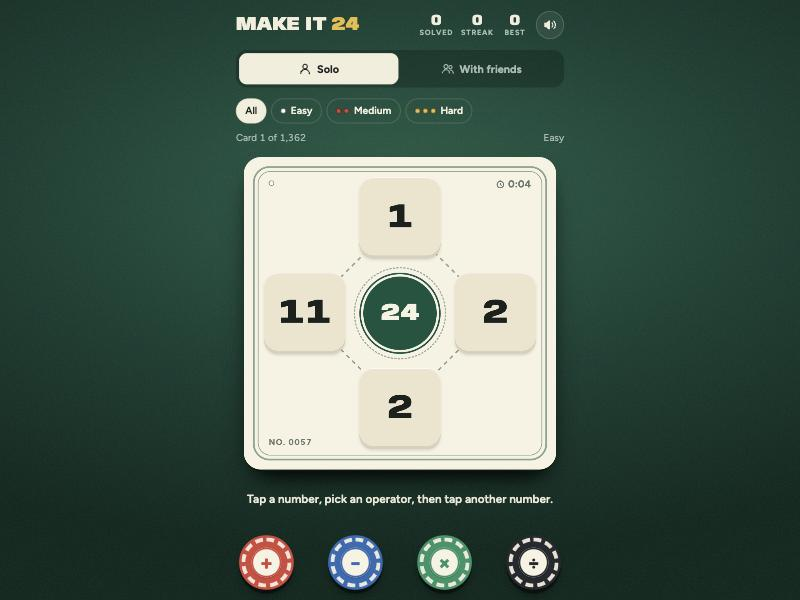

# Make it 24

Use four numbers and + − × ÷ to make 24. Play solo through 1,362 cards, or race your friends online.

### ▶ [Play now](https://granodioritee.github.io/make-it-24/)

## Features

- 1,362 cards with numbers 1 to 13, every one solvable, sorted into easy, medium and hard
- Solo mode with streaks, hints, and the answer when you're stuck
- Race your friends: share a room link, everyone gets the same card, 5 minutes per round, points for finishing 1st, 2nd and beyond
- Works in any phone browser, no account or install needed

## How it's built

One HTML file with no build step, hosted on GitHub Pages. Multiplayer runs on Firebase Realtime Database with anonymous sign-in. The security rules in `database.rules.json` check every write and time each solve with the server's clock, so nobody can fake a finish.

---

Made by [granodioritee](https://github.com/granodioritee). Also try [Spy Words](https://github.com/granodioritee/spy-words) and [Werewolf](https://github.com/granodioritee/werewolf).
